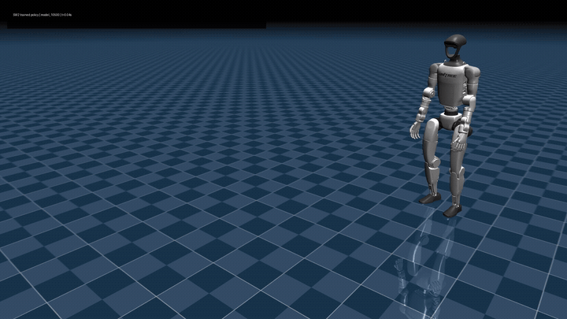

# Sword motion retargeting for Unitree G1

This branch contains one complete BVH to G1 example:

1. source motion captured in a mocap suit;
2. GMR retargeting for the Unitree G1 29-DoF model;
3. training-ready MJLab motion;
4. the final RL checkpoint and exported ONNX policy.



The preview was recorded from `model_10500.pt`. The branch contains the later
and final `model_11999.pt` checkpoint.

## Quick start

Clone the branch together with the pinned GMR source:

```bash
git clone --recurse-submodules \
  --branch retargeting_g1 \
  https://github.com/neurobiomorphic-technologies-Lab-MIPT/neurohumanoid_RL.git

cd neurohumanoid_RL
./retargeting/setup.sh
./retargeting/run.sh
```

The last command retargets the included BVH and writes
`assets/retargeted/sw2_1_chr01_MAYA_G1_GMR.pkl`. The GMR viewer requires a
desktop session with working OpenGL.

To process another Nokov BVH:

```bash
./retargeting/run.sh \
  --input /path/to/motion.bvh \
  --output /path/to/motion_g1.pkl
```

## Files

| Path | Description |
| --- | --- |
| `assets/source/sw2_1_chr01_MAYA.bvh` | Original 90 FPS sword motion |
| `assets/retargeted/sw2_1_chr01_MAYA_G1_GMR.pkl` | GMR output for Unitree G1, 29 joints |
| `assets/training/sw2_1_chr01_MAYA_G1_GMR_fixed_start.npz` | MJLab motion used for policy playback and follow-up training |
| `checkpoints/sw2_g1/model_11999.pt` | Final RSL-RL checkpoint after 12,000 iterations |
| `checkpoints/sw2_g1/policy.onnx` | ONNX export produced by the final training run |
| `metadata.json` | Machine-readable motion, repository and training metadata |
| `SHA256SUMS` | Checksums for the source, motion and policy files |
| `retargeting/GMR` | GMR source pinned to the tested commit |
| `retargeting/setup.sh` | Creates the Python environment and installs GMR |
| `retargeting/run.sh` | Retargets the included BVH or a custom Nokov BVH |

The original GMR result contains a discontinuity between its first two frames.
It produces an invalid root velocity of about 51 m/s. In the training-ready NPZ,
the first two samples are replaced with the first continuous sample. No other
part of the motion is changed.

## Retargeting

The motion was retargeted with the project GMR fork at commit
[`74c725c`](https://github.com/guoshuhao066-code/GMR/commit/74c725cdb3b4ca19af00eec500fdcd520f0bcd53).
That fork is based on
[`YanjieZe/GMR`](https://github.com/YanjieZe/GMR).

```bash
python retargeting/GMR/scripts/bvh_to_robot.py \
  --bvh_file assets/source/sw2_1_chr01_MAYA.bvh \
  --format nokov \
  --robot unitree_g1 \
  --motion_fps 90 \
  --save_path assets/retargeted/sw2_1_chr01_MAYA_G1_GMR.pkl
```

The PKL stores:

- `fps`: 90
- `root_pos`: `(8829, 3)`
- `root_rot`: `(8829, 4)`, quaternion order `xyzw`
- `dof_pos`: `(8829, 29)`

MJLab converts the root pose and joint trajectory into a 50 FPS NPZ with body
poses and velocities. The resulting motion has 4,905 samples and lasts 98.1 s.

## Training

Training used commit
[`9f3b2bb`](https://github.com/neurobiomorphic-technologies-Lab-MIPT/neurohumanoid_RL/commit/9f3b2bbf375e497f8337ac029ff23293066747cf)
from the `dance_train` branch.

```bash
cd unitree_rl_mjlab

python scripts/train.py Unitree-G1-Tracking-No-State-Estimation \
  --motion-file ../assets/training/sw2_1_chr01_MAYA_G1_GMR_fixed_start.npz \
  --env.scene.num-envs=4096 \
  --agent.max-iterations=12000 \
  --agent.run-name=sw2_g1_12k
```

The recorded run used one RTX 3060 and completed checkpoint `model_11999.pt`.
The checkpoint is the PyTorch training artifact. `policy.onnx` is the deployment
export created by the same run.

To play the checkpoint with the `dance_train` code:

```bash
python scripts/play.py Unitree-G1-Tracking-No-State-Estimation \
  --motion-file /absolute/path/to/sw2_1_chr01_MAYA_G1_GMR_fixed_start.npz \
  --checkpoint-file /absolute/path/to/model_11999.pt \
  --num-envs 1 \
  --device cuda:0 \
  --viewer native
```

## Repositories and technology

| Component | Repository or package | Role |
| --- | --- | --- |
| Motion retargeting | [YanjieZe/GMR](https://github.com/YanjieZe/GMR) and the [project fork](https://github.com/guoshuhao066-code/GMR/tree/g1-dance-pipeline) | Maps the human BVH skeleton to G1 root pose and 29 joint angles |
| Training project | [`neurohumanoid_RL`, `dance_train`](https://github.com/neurobiomorphic-technologies-Lab-MIPT/neurohumanoid_RL/tree/dance_train) | G1 task configuration, preprocessing, training and playback |
| RL environment | [MJLab](https://github.com/mujocolab/mjlab) 1.2.0 | Manager-based environments and motion-tracking task API |
| Physics | [MuJoCo](https://github.com/google-deepmind/mujoco) 3.7.0 | Robot model, contacts and rigid-body dynamics |
| GPU simulation | [MuJoCo Warp](https://github.com/google-deepmind/mujoco_warp) 3.5.0 | Parallel MuJoCo simulation for 4,096 environments |
| RL algorithm | [RSL-RL](https://github.com/leggedrobotics/rsl_rl) 5.0.1 | PPO runner, actor and critic training |
| Neural network runtime | [PyTorch](https://github.com/pytorch/pytorch) 2.12.0 | Training and checkpoint execution |
| Deployment format | [ONNX](https://onnx.ai/) and ONNX Runtime 1.26.0 | Portable policy export and inference |

The source BVH is included as the input asset for this reproducible example.

## Integrity check

```bash
sha256sum -c SHA256SUMS
```
neurohumanoid_RL
