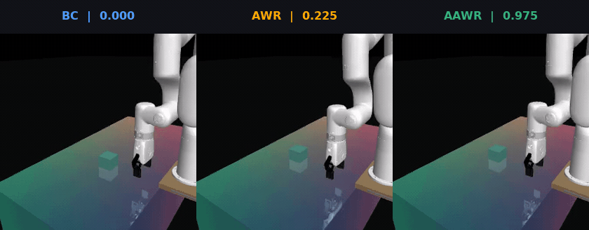

# Stage 0 — official AAWR simulation reproduction

## Question

Can the public AAWR implementation reproduce its documented advantage over BC
and unprivileged AWR on the toy simulated xArm lift task?

## Visual result



Seed-41 final evaluation rollouts after 40,000 updates. The AAWR episode ends
successfully and its last frame is held while the longer BC/AWR rollouts
continue. Labels show the 40-episode final evaluation success rate, not the
outcome of the single displayed rollout.

## Upstream starting point

- Code: <https://github.com/penn-pal-lab/aawr>
- Environment: `gym-xarm`, linked by the upstream setup instructions
- Training entrypoint: `src/train_il.py`
- Initial task: `gymnasium_xarm_lift`

Pinned upstream revisions:

```text
aawr commit:     05845db6c0da25993e816c44f47c123487f20cd1
gym-xarm commit: 388227ab683516d014bb7273350ac78c10faf84b
```

The upstream dependency files are stale relative to the January 2026 xArm
integration. The verified local stack is Python 3.11, PyTorch 2.10.0+cu128,
Gymnasium 1.3.0, Gymnasium-Robotics 1.4.2, MuJoCo 3.3.7, and NumPy 1.26.4.
Exact non-PyTorch pins are in [`requirements-stage0.txt`](requirements-stage0.txt).

The local AAWR patches add resolved-config output, extend the evaluation CSV,
and fix an upstream BC offline-to-online signature mismatch by accepting and
ignoring the unused `demo_buffer` argument. They do not change BC updates or the
AAWR/AWR algorithms. See [`patches/`](patches/).

## Deployment

From the repository root:

```bash
./experiments/00_official_sim/bootstrap.sh
```

The bootstrap script clones the two pinned repositories into ignored
`.external/` directories, creates `.venv`, installs pinned dependencies, applies
the local logging patch, and executes a headless reset/step/render smoke test.
It refuses unexpected upstream revisions or source changes.

No online experiment tracker is used. `WANDB_MODE=disabled` and
`use_wandb=false` are both set by the runner.

## Dataset

Generate the 100 official scripted demonstrations with a fixed NumPy seed:

```bash
./experiments/00_official_sim/generate_demos.sh
```

The generated dataset is ignored by Git. Its identity and measured statistics
are recorded in [`dataset-manifest.yaml`](dataset-manifest.yaml). The generator
refuses to overwrite an existing dataset.

## Run matrix

| Method | Actor input | Critic input | Required |
| --- | --- | --- | --- |
| BC | RGB | — | Yes |
| AWR | RGB | RGB | Yes |
| AAWR | RGB | privileged 7-D simulator state | Yes |

All methods use the same demonstrations, action space, training budget, and
evaluation schedule. BC/AWR run with `modality=pixels`; AAWR runs with
`modality=all`, but its policy encoder consumes only RGB.

Run one experiment at a time:

```bash
./experiments/00_official_sim/run_experiment.sh aawr 41
./experiments/00_official_sim/run_experiment.sh awr 41
./experiments/00_official_sim/run_experiment.sh bc 41
```

The main matrix uses seeds 41, 42, and 43, 20,000 offline updates, and 40,000
total updates. The runner refuses to repeat a completed method/seed result.
Generated logs, resolved configs, and videos remain under ignored `results/`
and `.external/aawr/logs/` directories. Aggregate findings belong in the tracked
[`report.md`](report.md).

After validating one full run, execute the remaining matrix sequentially:

```bash
./experiments/00_official_sim/run_main_matrix.sh
```

The matrix runner skips completed result CSVs and never runs two GPU jobs at the
same time.

Summarize any completed runs without modifying them:

```bash
.venv/bin/python experiments/00_official_sim/summarize_results.py
```

After seed 41 is complete for all three methods, build compact presentation
videos:

```bash
.venv/bin/python experiments/00_official_sim/build_result_videos.py
```

This produces three labeled final rollouts and one side-by-side comparison in
ignored `results/stage0/videos/`. The comparison is 960×372, contains no audio,
uses H.264 with fast-start metadata, and is intended to stay small enough for a
README link or presentation. Raw checkpoint videos remain outside Git.

After the main comparison, run full/noisy/zero privileged-state ablations for
AAWR.

## Outputs

- environment and installation notes;
- pinned source revisions and dataset manifest;
- exact commands and resolved configs;
- per-seed success rate, return, and episode length;
- aggregate learning curves and rollout videos;
- a short report explaining differences from upstream results.

## Definition of done

A clean checkout can execute a headless smoke test and reproduce a documented,
matched-budget BC/AWR/AAWR comparison.
